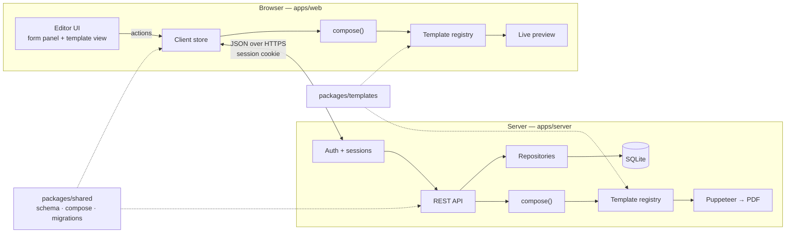
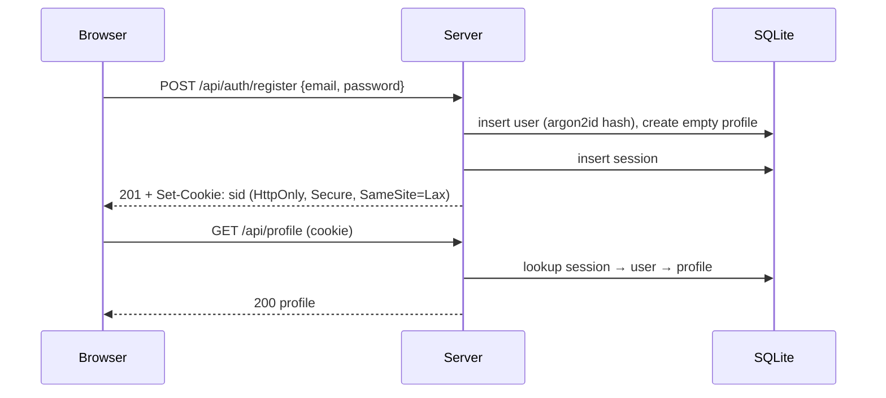

# cv-craft — Architecture

| | |
| --- | --- |
| **Status** | Draft |
| **Last updated** | 2026-10-31 |
| **Stack** | React (JavaScript) · Node/Express · SQLite · Puppeteer |

## 1. Summary

cv-craft is a web application for maintaining professional information once and producing multiple resumes from it. A user signs in, fills in a single structured **profile** (personal details, education, experience, skills, projects, certifications, achievements, and any custom sections), creates one or more **resumes** from that profile, picks a **template** for each, and downloads a PDF.

The central design constraint is that **data and design are independent**. The profile has no knowledge of templates, and templates never own data. Adding a new template must not require changes to the data model, the API, the database, or the editor.

## 2. Goals and non-goals

### Goals

- One canonical, versioned profile schema per user that every template can render.
- Multiple resume versions per user, each choosing a template, section order, visibility, and per-version text overrides, without duplicating profile data.
- Ship with 4–5 templates; adding a template is a self-contained change (one folder + one registry entry).
- Users can add, edit, remove, and reorder sections and entries directly from the template view, with changes persisting to the profile and appearing in every template.
- Downloadable PDFs that match the on-screen preview, with selectable text.
- Optional profile photo, shown only by templates that support it and only when enabled per resume.
- Simple email/password authentication.
- Leave clean extension points for AI-assisted content generation.

### Non-goals (v1)

- OAuth / social login, self-service password reset, email verification, MFA.
- More than one profile per user (planned; see §16).
- Teams, sharing, or public resume pages.
- User-authored templates or a free-form layout designer (drag elements anywhere).
- Real-time collaboration or multi-device conflict resolution beyond last-write protection.
- AI features (designed for, not built).

## 3. Core concepts

| Concept | What it is | Owned by | Stored in |
| --- | --- | --- | --- |
| **Profile** | The user's facts. No layout, styling, or template ids. | User | `profiles.data` (JSON) |
| **Resume** | A version: template choice, section order, hidden items, text overrides, template options. References the profile; never copies it. | User | `resumes.settings` (JSON) |
| **Template** | Presentation code. Turns a render model into print-ready HTML. | Codebase | `packages/templates` |
| **Render model** | Profile with a resume's choices applied. The only input a template receives. | Derived | Not stored |

The relationship is one-directional:

```
Profile ──┐
          ├── compose() ──► Render model ──► Template ──► HTML ──► Preview / PDF
Resume ───┘
```

## 4. System overview



Key properties:

- **The schema and `compose()` are shared** between client and server, so validation and rendering logic exist exactly once.
- **Templates are shared** between client (live preview) and server (PDF). Preview and PDF come from the same component, so they cannot drift.
- **The server is the source of truth** for persisted data; the client holds a working copy and saves on change.

## 5. Tech stack

| Layer | Choice | Rationale |
| --- | --- | --- |
| Frontend | React + JavaScript, Vite | Requested; fast dev loop |
| Client state | Zustand (single store, action-based) | Small API; all mutations go through named actions |
| Routing | React Router | Standard |
| Validation | Zod | Runtime schemas in plain JS, shared by client and server |
| Backend | Node.js (LTS) + Express | Same language end to end |
| Database | SQLite via `better-sqlite3` | Zero-ops single file; profile stored as JSON. Portable to Postgres (`jsonb`) later |
| Auth | Session cookies, `argon2` password hashing | Simple, secure default for a first-party web app |
| PDF | Puppeteer (headless Chromium) | Renders the same HTML/CSS as the preview |
| Images | `sharp` | Photo validation, cropping, re-encoding, metadata stripping |
| Tooling | npm workspaces, ESLint, Prettier, Vitest, Supertest, Playwright | Monorepo with shared packages; unit, API, and E2E coverage |

JavaScript is used throughout. Public functions in `packages/shared` carry JSDoc types so editors still provide autocomplete; Zod schemas are the runtime contract.

## 6. Repository layout

```
cv-craft/
├── package.json                 # npm workspaces root
├── packages/
│   ├── shared/
│   │   └── src/
│   │       ├── schema/          # Zod: profile, sections, items, resume settings
│   │       ├── defaults/        # empty profile, empty item per section type
│   │       ├── compose/         # compose(profile, resume) → render model
│   │       ├── migrations/      # schemaVersion upgrades
│   │       └── format/          # date ranges, phone, URL display helpers
│   └── templates/
│       └── src/
│           ├── registry.js      # list of templates; the only place templates are enumerated
│           ├── kit/             # <Page>, <Section>, <Item>, <GenericSection>, editable wrappers
│           ├── classic/
│           ├── sidebar/
│           ├── compact/
│           ├── executive/
│           └── technical/
├── apps/
│   ├── web/
│   │   └── src/
│   │       ├── pages/           # Login, Register, Dashboard, ResumeEditor
│   │       ├── store/           # Zustand store, actions, autosave
│   │       ├── editor/          # form panel, item drawers, add-section dialog
│   │       ├── preview/         # template host, zoom, page breaks
│   │       └── api/             # fetch client
│   └── server/
│       └── src/
│           ├── routes/          # auth, profile, photos, resumes, templates, pdf
│           ├── middleware/      # requireAuth, validate, errorHandler, rateLimit
│           ├── repos/           # users, sessions, profiles, resumes, photos
│           ├── cli/             # operator commands (password reset)
│           ├── pdf/             # browser pool, render-to-html, print
│           └── db/              # connection, SQL migrations
└── ARCHITECTURE.md
```

**Dependency rules** (enforced by lint import restrictions):

- `shared` depends on nothing internal.
- `templates` depends on `shared` (types, formatters) only. It never imports from `apps/*`.
- `apps/web` and `apps/server` depend on `shared` and `templates`.
- No template is imported by name outside `registry.js`.

## 7. Data model

### 7.1 Profile document

One profile per user in v1 (multiple profiles are planned; see §7.7). Stored as a JSON document validated by the shared Zod schema.

```json
{
  "schemaVersion": 1,
  "basics": {
    "fullName": "Jane Doe",
    "headline": "Senior Backend Engineer",
    "email": "jane@example.com",
    "phone": "+1 555 0100",
    "location": "Bengaluru, IN",
    "photo": { "id": "ph_8Kq2", "width": 600, "height": 600 },
    "links": [
      { "id": "lnk_1", "label": "GitHub", "url": "https://github.com/janedoe" }
    ]
  },
  "summary": "Backend engineer with 8 years building payment systems…",
  "sections": [
    {
      "id": "sec_exp",
      "type": "experience",
      "title": "Experience",
      "items": [
        {
          "id": "exp_1",
          "role": "Senior Engineer",
          "organization": "Acme Pay",
          "location": "Remote",
          "startDate": "2021-04",
          "endDate": null,
          "current": true,
          "bullets": ["Led migration of ledger service to event sourcing…"]
        }
      ]
    },
    {
      "id": "sec_vol",
      "type": "custom",
      "title": "Volunteering",
      "items": [
        {
          "id": "cus_1",
          "heading": "Mentor",
          "subheading": "Code Club",
          "location": "",
          "startDate": "2019-01",
          "endDate": null,
          "current": true,
          "description": "",
          "bullets": []
        }
      ]
    }
  ]
}
```

### 7.2 Section types

`sections` is an ordered array. Each section has a stable `id`, a `type`, a user-editable `title`, and `items`. Each item has a stable `id`.

| Type | Item fields |
| --- | --- |
| `experience` | role, organization, location, startDate, endDate, current, bullets[] |
| `education` | degree, field, institution, location, startDate, endDate, grade, bullets[] |
| `skills` | name, category, level (optional) |
| `projects` | name, role, url, startDate, endDate, description, technologies[], bullets[] |
| `certifications` | name, issuer, date, expiryDate, credentialId, url |
| `achievements` | title, issuer, date, description |
| `custom` | heading, subheading, location, startDate, endDate, current, description, bullets[] |

Design rules:

- **Facts, not formatting.** Dates are stored as `YYYY-MM` (or `YYYY-MM-DD`) strings; templates format them. Skills are items with an optional category; whether they render as chips, a list, or columns is a template decision.
- **Multiple sections of the same type are allowed** (e.g. two `experience` sections titled "Industry" and "Research").
- **`custom` is the escape hatch.** Any section a user invents (Volunteering, Publications, Languages, Interests) uses the generic shape and renders in every template with no code change.
- **Plain text content.** Bullets and descriptions are plain text in v1. A restricted inline format (bold/italic/links only) may be added later as an additive change.
- **IDs are generated client-side** (`nanoid`) so newly added items can be referenced immediately, before the save round-trip completes.

### 7.3 Resume settings

```json
{
  "templateId": "sidebar",
  "templateVersion": 1,
  "sectionOrder": ["sec_exp", "sec_edu", "sec_skl", "sec_vol"],
  "hiddenSections": [],
  "hiddenItems": ["edu_2"],
  "overrides": {
    "basics.headline": "Platform Engineer",
    "summary": "Tailored summary for this application…",
    "items": {
      "exp_1": { "bullets": ["Rewritten bullet for this role…"] }
    }
  },
  "options": {
    "accent": "#1f6feb",
    "fontPair": "inter-merriweather",
    "density": "comfortable",
    "pageSize": "A4",
    "showPhoto": false
  }
}
```

- **Overrides are sparse.** Anything not overridden is inherited from the profile, so profile edits flow into every resume automatically.
- **Sections or items not in `sectionOrder`** (e.g. added to the profile after the resume was created) are appended in profile order, so new content is never silently missing.
- **Dangling references** (ids that no longer exist in the profile) are ignored by `compose()` and pruned on the next save.
- **`options`** are validated against the selected template's options schema. Unknown keys are dropped; missing keys take template defaults. Switching templates keeps options the new template also understands.

### 7.4 Database schema

```sql
CREATE TABLE users (
  id             TEXT PRIMARY KEY,          -- nanoid
  email          TEXT NOT NULL UNIQUE COLLATE NOCASE,
  password_hash  TEXT NOT NULL,             -- argon2id
  display_name   TEXT,
  created_at     TEXT NOT NULL,
  updated_at     TEXT NOT NULL
);

CREATE TABLE sessions (
  id          TEXT PRIMARY KEY,             -- 256-bit random, stored hashed
  user_id     TEXT NOT NULL REFERENCES users(id) ON DELETE CASCADE,
  expires_at  TEXT NOT NULL,
  created_at  TEXT NOT NULL
);

CREATE TABLE profiles (
  id              TEXT PRIMARY KEY,
  user_id         TEXT NOT NULL UNIQUE REFERENCES users(id) ON DELETE CASCADE,
  schema_version  INTEGER NOT NULL,
  data            TEXT NOT NULL,            -- JSON, validated by shared schema
  revision        INTEGER NOT NULL DEFAULT 1,
  updated_at      TEXT NOT NULL
);

CREATE TABLE resumes (
  id           TEXT PRIMARY KEY,
  user_id      TEXT NOT NULL REFERENCES users(id) ON DELETE CASCADE,
  profile_id   TEXT NOT NULL REFERENCES profiles(id) ON DELETE CASCADE,
  name         TEXT NOT NULL,
  template_id  TEXT NOT NULL,
  settings     TEXT NOT NULL,               -- JSON, validated by shared schema
  revision     INTEGER NOT NULL DEFAULT 1,
  created_at   TEXT NOT NULL,
  updated_at   TEXT NOT NULL
);

CREATE TABLE photos (
  id          TEXT PRIMARY KEY,
  user_id     TEXT NOT NULL REFERENCES users(id) ON DELETE CASCADE,
  mime_type   TEXT NOT NULL,                -- image/jpeg or image/webp after re-encoding
  bytes       INTEGER NOT NULL,
  created_at  TEXT NOT NULL
);

CREATE INDEX idx_resumes_user ON resumes(user_id);
CREATE INDEX idx_resumes_profile ON resumes(profile_id);
CREATE INDEX idx_sessions_user ON sessions(user_id);
```

Photo binaries live on disk under `UPLOAD_DIR/<user_id>/<photo_id>`; the table records ownership and metadata. `resumes.profile_id` is redundant while each user has one profile, but it is in place from day one so supporting multiple profiles later needs no data migration for resumes.

**Why a JSON document instead of normalized tables per section:** the profile is always read and written as a whole, never queried across users, and its shape will grow (new section types, new fields). A document avoids a migration per schema addition and keeps the server free of per-section CRUD. Schema evolution is handled in application code (§7.5). Moving to Postgres later maps `data` to `jsonb` with no model change.

`resumes.template_id` is duplicated out of `settings` only so the dashboard can list resumes without parsing JSON.

### 7.5 Schema versioning and migrations

- Every profile carries `schemaVersion`.
- `packages/shared/migrations` exports an ordered list of pure functions `vN → vN+1`.
- On read, the server migrates the document to the current version and writes it back.
- Additive changes (new optional field, new section type) do not bump the version. Renames, restructures, or semantic changes do.
- Imported JSON goes through the same migration path.

### 7.6 Photos

- One photo per profile, optional. Uploaded as JPEG, PNG, or WebP, ≤ 5 MB.
- The server decodes, strips metadata (EXIF, including GPS), center-crops to square, resizes to 600×600, and re-encodes to JPEG with `sharp`. Anything that fails to decode is rejected.
- `basics.photo` stores only the photo id and dimensions. Replacing a photo deletes the previous file.
- Templates declare photo support through their options schema (`showPhoto`). The default is `false` in every template; the user turns it on per resume. Templates without photo support ignore the field.
- Photos are served only to their owner (`GET /api/photos/:id`, auth required) and inlined as data URIs in PDFs.

### 7.7 Multiple profiles (planned)

v1 has one profile per user. The planned extension lets a user keep several profiles (for example, separate career tracks) and move them in and out as JSON files.

The current design keeps this a small change:

- Drop `UNIQUE` on `profiles.user_id` and add a `name` column.
- `resumes.profile_id` already exists, so each resume already knows its profile.
- Profile routes become `/api/profiles/:id/...`; `/api/profile` remains as an alias for the user's default profile.
- The export format (§11) is already a self-contained JSON file with `schemaVersion`, so importing creates a new profile instead of replacing the existing one.
- The profile schema, `compose()`, templates, and the editor do not change.

## 8. Rendering pipeline

### 8.1 `compose(profile, resume) → renderModel`

A pure, deterministic function in `packages/shared`. Same input always yields the same output; it has no I/O.

Steps:

1. Apply text overrides (`basics.*`, `summary`, per-item fields).
2. Order sections by `resume.sectionOrder`; append any sections not listed.
3. Remove hidden sections and hidden items.
4. Drop empty sections (no visible items).
5. Attach resolved template options (defaults merged with resume options).

Render model shape:

```json
{
  "basics": { "...": "..." },
  "summary": "…",
  "sections": [
    { "id": "sec_exp", "type": "experience", "title": "Experience", "items": [ { "id": "exp_1", "...": "..." } ] }
  ],
  "options": { "accent": "#1f6feb", "density": "comfortable", "pageSize": "A4" }
}
```

Templates receive only this object. They never see hidden data, raw overrides, or storage concerns.

### 8.2 Template contract

Each template is a folder exporting a definition object, registered in `registry.js`:

| Field | Purpose |
| --- | --- |
| `id`, `version` | Stable identifier; version bumps on breaking visual changes |
| `name`, `description`, `thumbnail` | Template picker |
| `defaultSectionOrder` | Preferred order by section type for new resumes |
| `sectionRenderers` | Map of section type → component. May omit types. |
| `optionsSchema`, `defaultOptions` | Zod schema for options this template exposes (accent, font pair, density, photo, columns) |
| `Component` | Root component: receives `{ model, mode }`, renders pages |
| `styles` | Template-scoped CSS, including `@page` and print rules |

Rules every template must follow:

1. **Input is the render model only.** No store access, no fetches, no globals.
2. **Unknown or unsupported section types fall back to `<GenericSection>`** from the kit. Nothing is silently dropped.
3. **Use kit primitives** (`<Section>`, `<Item>`, `<Field>`) to wrap rendered content. These carry `data-section-id` / `data-item-id` and provide editing affordances in edit mode (§9). In print mode they render plain markup.
4. **Pagination-safe CSS.** Entries use `break-inside: avoid`; only bullet lists may break across pages. Page size comes from `options.pageSize`.
5. **Self-hosted fonts only**, so server-side PDF output is deterministic.
6. **Real text.** No rasterized content; PDFs must stay selectable and ATS-readable.

### 8.3 Adding a template

1. Create `packages/templates/src/<id>/` with the definition, components, styles, and thumbnail.
2. Add it to `registry.js`.
3. Run the template contract test suite (§13), which renders every fixture profile through the new template.

No changes to `shared`, `apps/server`, `apps/web`, or the database are required.

### 8.4 Initial templates

| Id | Style | Notes |
| --- | --- | --- |
| `classic` | Single column, conventional headings | ATS-first default |
| `sidebar` | Two columns; contact, skills, education in the rail | Rail placement is a template decision by section type; overflow continues in main column |
| `compact` | Dense single column, smaller type scale | Targets one page |
| `executive` | Serif, summary and achievements emphasized | More whitespace |
| `technical` | Projects and skills emphasized, tech tags on projects | Experience still first by default |

## 9. Editing model

### 9.1 One mutation path

All changes to profile or resume data go through named store actions. Neither the form panel nor the template view mutates state directly.

| Action | Target | Effect |
| --- | --- | --- |
| `addSection(type, title?)` | profile | Appends a section with one empty item; adds it to the current resume's order |
| `renameSection(sectionId, title)` | profile | |
| `removeSection(sectionId)` | profile | Confirmation required; removes from all resumes |
| `addItem(sectionId, afterItemId?)` | profile | Inserts an empty item of the section's type |
| `updateItem(sectionId, itemId, patch)` | profile | Shallow field patch, validated |
| `removeItem(sectionId, itemId)` | profile | Undoable |
| `moveItem(sectionId, itemId, toIndex)` | profile | |
| `updateBasics(patch)` / `updateSummary(text)` | profile | |
| `reorderSections(order)` | resume | Per-version ordering |
| `toggleHidden(id)` | resume | Hide a section or item in this version only |
| `setOverride(path, value)` / `clearOverride(path)` | resume | Per-version wording |
| `setTemplate(templateId)` | resume | Options re-resolved against the new template |
| `setOption(key, value)` | resume | |

The distinction that keeps templates interchangeable:

- **Content** (what is true) → profile → visible in every resume.
- **Composition** (what this version shows, in what order, with what wording) → resume.
- **Presentation** (how it looks) → resume options, constrained by the template's options schema.

### 9.2 Editing on the template

The template view has two modes:

- **Edit mode (default in the editor).** Kit primitives render hover controls around sections and items:
  - Section: rename, move up/down, hide in this resume, delete, **+ Add item**.
  - Item: edit (opens a side drawer with that item's form), duplicate, move, hide, delete.
  - End of document: **+ Add section** (pick a standard type or create a custom one).
  - Short single-line fields (name, headline, titles) support inline click-to-edit; multi-field items use the drawer.
- **Preview mode.** Exactly what the PDF will contain; no controls.

Because the controls live in the kit, every template gets editing for free, and template authors write layout only.

Edits made on the template always write to the **profile** and therefore apply to every resume. The UI does not prompt for scope. Per-resume wording is an explicit action: the field's menu offers **Tailor for this resume**, which creates an override (`setOverride`). Overridden fields show a marker and a **Revert to profile** action (`clearOverride`).

### 9.3 Undo, autosave, conflicts

- The store keeps a bounded undo/redo history (last 50 actions) per session.
- Autosave: debounced 1s after the last action, plus on page hide. The UI shows *Saving…*, *Saved*, or *Offline — changes pending*.
- Writes send the last known `revision`. If the server revision is newer (e.g. the user edited in another tab), the server returns `409` and the client offers to reload or overwrite. No merging in v1.

## 10. Authentication

Scope: email + password, first-party sessions. Nothing else.

### Flow



### Details

- Passwords hashed with **argon2id**; minimum length 8, maximum 128; no composition rules.
- Session id: 256-bit random value. The cookie holds the raw value; the database stores a SHA-256 hash, so a leaked database cannot be used to hijack sessions.
- Cookie: `HttpOnly`, `Secure` (in production), `SameSite=Lax`, `Path=/`, 30-day sliding expiry.
- Logout deletes the session row. Changing a password deletes all of the user's other sessions.
- Login and register are rate-limited per IP and per email (e.g. 10 attempts / 15 min).
- Login errors are generic ("Invalid email or password") to avoid account enumeration.
- CSRF: `SameSite=Lax` plus a JSON-only API (`Content-Type: application/json` required on mutating routes) plus an `Origin` header check.
- Every data route is behind `requireAuth`, and every query is scoped by `user_id` from the session, never from the request body or URL.
- Users change their own password from settings (current password required).

### Password reset (v1)

There is no self-service reset in v1, because there is no email infrastructure. An operator resets a password with a server-side CLI command, `npm run user:reset-password -- <email>`, which prints a one-time temporary password, deletes all of that user's sessions, and flags the account so the user must choose a new password at next login. Self-service reset by email is future work (§16).

## 11. API

All routes are under `/api`, JSON in and out. Errors use one shape:

```json
{ "error": { "code": "VALIDATION_FAILED", "message": "…", "details": [ { "path": "sections.0.items.1.startDate", "message": "Invalid date" } ] } }
```

| Method | Path | Description |
| --- | --- | --- |
| POST | `/auth/register` | Create account + empty profile, start session |
| POST | `/auth/login` | Start session |
| POST | `/auth/logout` | End session |
| GET | `/auth/me` | Current user, or `401` |
| POST | `/auth/change-password` | Requires current password; ends other sessions |
| GET | `/profile` | Current user's profile (migrated to latest schema) |
| PUT | `/profile` | Replace profile; body includes `revision`; `409` on conflict |
| GET | `/profile/export` | Download profile + resumes as a JSON file |
| POST | `/profile/import` | Validate, migrate, and replace profile (and optionally resumes) |
| POST | `/profile/photo` | Upload (multipart); processed per §7.6; sets `basics.photo` |
| DELETE | `/profile/photo` | Remove photo and clear `basics.photo` |
| GET | `/photos/:id` | Photo bytes; owner only |
| GET | `/resumes` | List resumes (id, name, templateId, updatedAt) |
| POST | `/resumes` | Create; optional `fromResumeId` to duplicate |
| GET | `/resumes/:id` | Resume settings |
| PUT | `/resumes/:id` | Replace settings; `revision` check |
| DELETE | `/resumes/:id` | Delete |
| GET | `/resumes/:id/pdf` | Render and stream PDF |
| GET | `/templates` | Registry metadata: id, name, thumbnail, options schema (as JSON Schema) |

Whole-document `PUT` is deliberate: the profile is small (typically < 50 KB), it keeps the server free of per-field endpoints, and it matches how the client store works. JSON request bodies are capped at 1 MB; photo uploads at 5 MB.

The export file is the portable form of a user's data and the basis for multiple profiles later (§7.7):

```json
{ "format": "cv-craft-export", "formatVersion": 1, "exportedAt": "2026-10-31T12:00:00Z", "profile": { "schemaVersion": 1, "...": "..." }, "resumes": [ { "name": "Backend - 1 page", "settings": { "...": "..." } } ] }
```

Photos are not included in v1 exports; `basics.photo` is cleared on import.

## 12. PDF generation

### Pipeline

1. `GET /resumes/:id/pdf` loads the profile and resume for the session user.
2. `compose()` produces the render model.
3. The server renders the template's `Component` in print mode with `react-dom/server` `renderToStaticMarkup`, wrapped in an HTML shell that inlines the template CSS and self-hosted fonts.
4. Puppeteer loads the HTML with `page.setContent`, waits for fonts (`document.fonts.ready`), and calls `page.pdf` with the page size from options, `printBackground: true`, and margins defined by the template's `@page` rule.
5. The response streams `application/pdf` with `Content-Disposition: attachment; filename="<name>-<resume>.pdf"`.

### Operational notes

- **Browser pool:** one long-lived Chromium instance, a new page per request, page closed after use. Concurrency limited (e.g. 3); excess requests queue.
- **Timeouts:** 15s per render; failure returns `503` with a retryable error code.
- **Isolation:** the page runs with JavaScript disabled and network requests blocked (all assets are inlined), so user content cannot fetch remote resources.
- **Escaping:** user content is rendered as React text nodes, never as raw HTML.
- **Photos:** included only when the resume has `showPhoto: true` and the template supports it; read from disk and inlined as a data URI (see §7.6).
- **Not cached** in v1. Rendering is fast enough, and caching invites staleness. If needed later, key by hash of the render model + template version.

## 13. Validation and testing

### Validation

- The same Zod schemas run in the client (inline form errors) and the server (authoritative on every write).
- Schemas are **lenient on drafts**: empty strings are allowed so users can save partial work. Structural invariants are strict: ids present and unique, known section types, valid date format when provided.
- The server rejects documents that fail validation with `422` and field-level `details`.

### Tests

| Layer | Tooling | What |
| --- | --- | --- |
| `shared` | Vitest | Schema accept/reject cases, `compose()` ordering, hiding, overrides, dangling ids, migrations |
| `templates` | Vitest + React Testing Library | **Contract suite** run against every registered template with fixture profiles (minimal, typical, maximal, every section type, unicode/RTL names, very long content). Asserts: no throw, every visible item id appears in output, unknown types use the generic renderer |
| `server` | Vitest + Supertest | Auth flows, ownership scoping (user A cannot read user B's resume), revision conflicts, validation errors |
| PDF | Vitest + Puppeteer | Smoke test per template: PDF produced, page count within bounds, text extractable |
| E2E | Playwright | Register → fill profile → add custom section from template view → switch template → download PDF |

Visual regression (screenshot diffs per template) is recommended once templates stabilize.

## 14. Security summary

- Session cookies as specified in §10; no tokens in `localStorage`.
- Authorization enforced by `user_id` scoping in every repository query.
- Input validated on every write; body size limits; rate limiting on auth routes.
- User content is never rendered as HTML; PDF renderer has JS and network disabled.
- Uploaded images are decoded and re-encoded server-side, metadata stripped, and served only to their owner.
- `helmet` defaults for security headers; strict CSP in production (self only, no inline scripts).
- Secrets (session pepper, if used) from environment variables; `.env` excluded from git.

## 15. Configuration and deployment

- Environment variables: `PORT`, `DATABASE_PATH`, `NODE_ENV`, `COOKIE_SECURE`, `PDF_CONCURRENCY`, `UPLOAD_DIR`.
- Development: Vite dev server proxies `/api` to Express.
- Production: Express serves the built frontend and the API from one origin (simplifies cookies and CORS). Deployable as a single container with Chromium installed.
- Backups: SQLite file + uploads directory, snapshotted on a schedule. Moving to Postgres is the trigger point for multi-instance deployment.

## 16. Future work

### AI-assisted content

AI features use the same data model and action layer. They do not know about templates.

- **Generate / improve:** draft a summary, rewrite bullets for impact, fix grammar. Output is a proposed patch shown as a diff; accepting applies it via `updateItem` / `setOverride`.
- **Tailor to a job description:** suggest which items to show or hide and propose per-resume overrides. Writes only to the resume, never the profile, unless the user promotes a change.
- **Server-side only:** a `/api/ai/*` route group calls the model provider, so keys never reach the browser. Requests and responses are validated against the same schemas.

### Other

- Rich inline text (bold/italic/links) as an additive schema change.
- Public share links for a resume (read-only, revocable).
- Multiple profiles per user, with JSON import/export per profile (design in §7.7).
- Self-service password reset and email verification (requires an email provider).
- Template marketplace / theme variants via `optionsSchema` presets.
- Postgres migration for multi-instance hosting.

## 17. Milestones

| # | Deliverable | Exit criteria |
| --- | --- | --- |
| M1 | `shared` schema, defaults, `compose()`; `classic` template; web app with form editor and live preview (in-memory state) | Profile edits render in `classic`; `compose()` unit tests green |
| M2 | Server, SQLite, auth, profile/resume APIs, autosave | Register, log in, and data persists across reloads; ownership tests green |
| M3 | PDF endpoint | Downloaded PDF matches preview for `classic`; smoke test green |
| M4 | Kit editing affordances (add/remove/reorder sections and items from the template view), custom sections | E2E: add a custom section from the template view; it appears after switching templates |
| M5 | Remaining templates (`sidebar`, `compact`, `executive`, `technical`), template picker, options, photo upload | All templates pass the contract suite; photo appears only where enabled |
| M6 | Multiple resumes, overrides, hide/show, import/export | Two resumes from one profile with different templates and overrides |

## 18. Decision log

| # | Decision | Date | Notes |
| --- | --- | --- | --- |
| D1 | One profile per user in v1 | 2026-10-31 | Multiple profiles with JSON import/export planned; schema prepared via `resumes.profile_id` (§7.7) |
| D2 | No scope prompt when editing on the template | 2026-10-31 | Edits write to the profile; per-resume wording via explicit **Tailor for this resume** (§9.2) |
| D3 | Profile photo supported in v1 | 2026-10-31 | Off by default in every template; enabled per resume (§7.6) |
| D4 | No self-service password reset in v1 | 2026-10-31 | Operator CLI reset; email-based reset is future work (§10) |

## 19. Open questions

None at present. New questions are added here and moved to the decision log once resolved.
